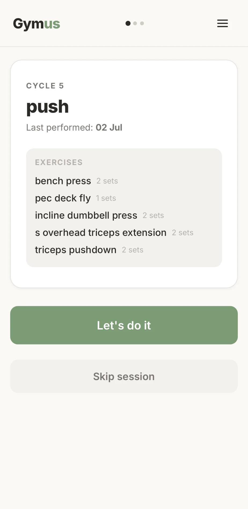
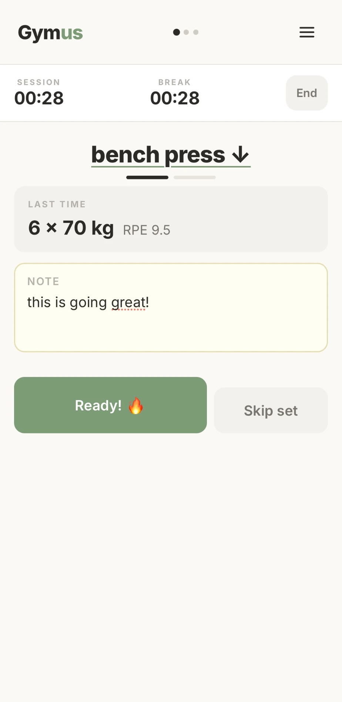
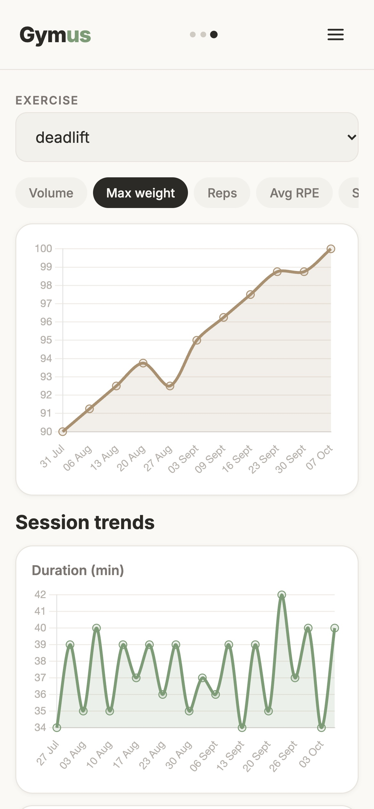
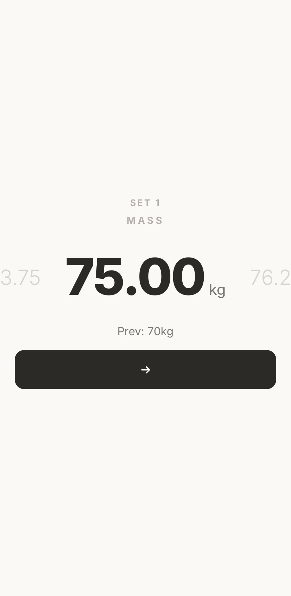
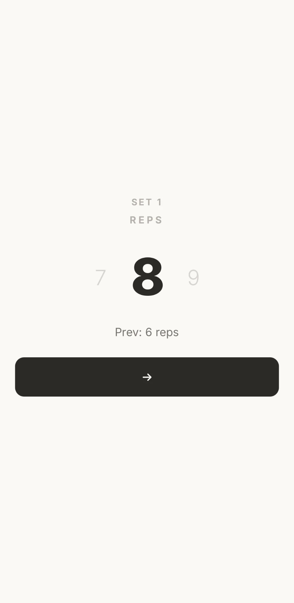
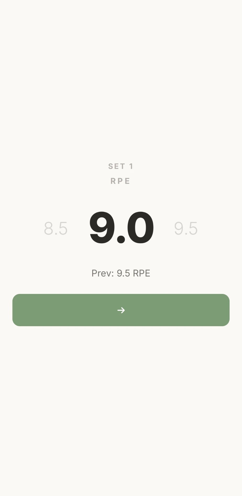
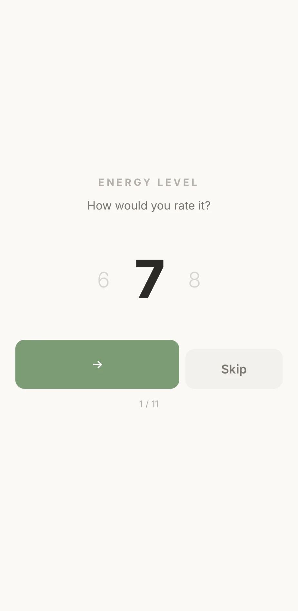
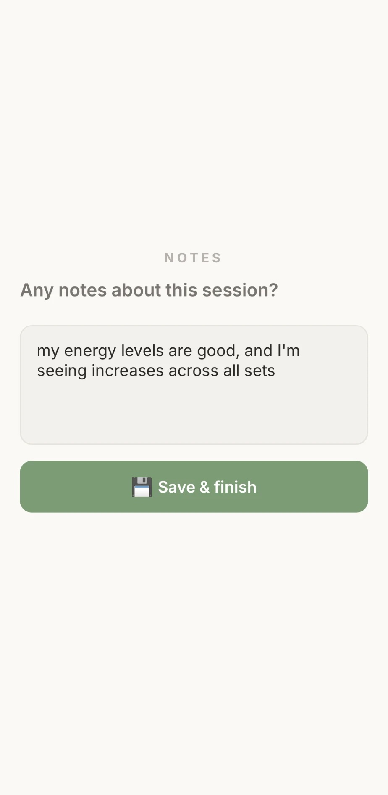
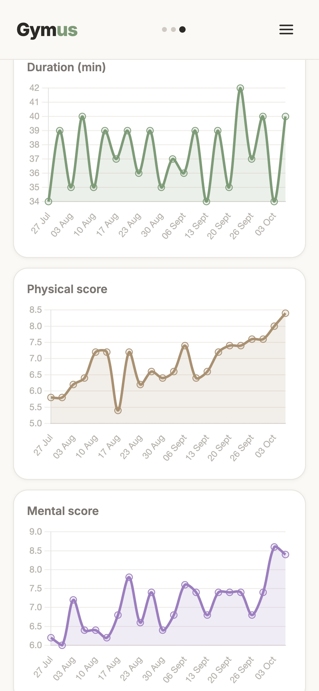
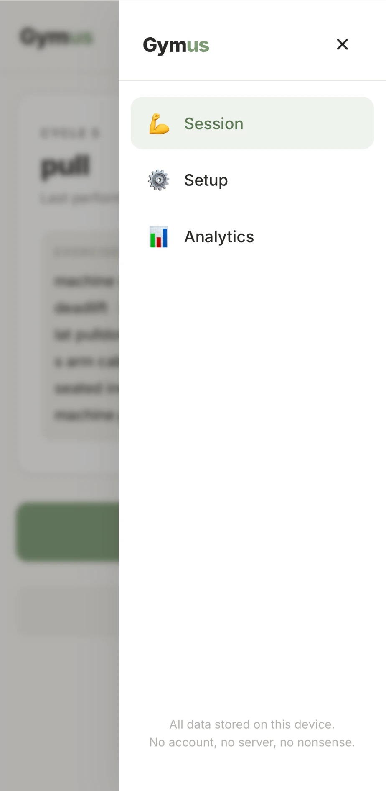

# Gymus

**Where gym meets focus.** An offline-capable, distraction-free session tracker for the gym. 100% local storage, zero server communication, and absolute data privacy. 🤸‍♂️

Gymus is a Progressive Web App built for one person and one phone. Add it to your iOS home screen from Safari and it behaves like a native app: it works in airplane mode, keeps your data on the device, and shows you one thing at a time so you can log a set with sweaty hands between reps.

<p align="center">
  
  
  
</p>

---

## Features

- **Cycle-based programmes.** Define a cycle of sessions (push, pull, legs and so on). Gymus always knows which session is next and when you last did it.
- **One prompt at a time.** Weight, reps and RPE are entered on full-screen drum pickers, each pre-filled with what you lifted last time.
- **Session and break timers.** The break timer starts the moment you tap *Done* and survives the app being closed or reloaded.
- **Per-exercise notes** carry over to the next time you do that session.
- **Post-session check-in.** Rate 11 aspects such as energy, sleep and focus, then add a free-text note.
- **Analytics.** Per-exercise charts (volume, max weight, reps, RPE, set and rest time, scatter plots) plus session-level trends for duration, physical score and mental score.
- **Offline first.** A service worker caches every asset; nothing is ever sent to a server.
- **Backup.** Export all data as JSON and import it again on another device.

## UI & UX

The interface is designed for use mid-workout: a warm off-white palette with muted sage accents, large type, touch targets of at least 52 px, and short transitions. At any moment only one thing asks for your attention.

### 1. Start the session

| Next session | During the break |
|:---:|:---:|
|  |  |
| The next session of the cycle, its exercises and when you last did it. Start it or skip it. | Session and break timers, what you did last time, and your note for this exercise. Tap the exercise name to jump to another one. |

### 2. Log the set

After tapping *Done*, three full-screen cards follow one another. Swipe the drum to change the value. *Prev* shows the matching set from last time.

| Weight | Reps | RPE |
|:---:|:---:|:---:|
|  |  |  |

### 3. Wrap up

| Check-in (1 of 11) | Session notes |
|:---:|:---:|
|  |  |
| Rate each item from 0 to 10. Skip twice in a row to end the check-in early. | Add a free-text note, then save and finish. |

### 4. Track progress

| Exercise charts | Session trends | Navigation |
|:---:|:---:|:---:|
|  |  |  |

## Getting started

**Live app: <https://atillaoezdemir.github.io/Gymus/>**

1. Open the link above in **Safari** on your iPhone.
2. Tap **Share → Add to Home Screen**.
3. Launch Gymus from the home screen, go to **Setup** and create your cycle.

After the first launch the app works fully offline.

## For developers

### Running locally

The app is plain HTML and JavaScript, so you don't need to install or build anything. Serve the folder with any static server:

```bash
python3 -m http.server 8000
```

Then open <http://localhost:8000>. Service workers need `localhost` or HTTPS, so opening `index.html` directly from disk will not enable offline mode.

## Tech stack

| Layer | Choice |
|---|---|
| UI | Vue 3 (CDN global build, no bundler) |
| Storage | Dexie.js on IndexedDB |
| Charts | Chart.js |
| Offline | `manifest.json` + hand-written `service-worker.js` |
| Font | Inter |

## Project structure

```
index.html          App shell, styles, root component and navigation
session.js          Pre-session, active session, set entry and check-in
setup.js            Cycle configuration, editing and JSON import/export
analytics.js        Exercise and session charts, session log browser
components.js       Drum picker, set indicator, stopwatch
db.js               Dexie schema and data access
service-worker.js   Offline cache (bump CACHE_NAME on every release)
manifest.json       PWA manifest
gymus.md            Full product specification
docs/screenshots/   Images used in this README
```

## Data and privacy

- Everything is stored in IndexedDB in your browser. There is no account, no server and no analytics.
- On startup Gymus asks the browser for persistent storage so iOS is less likely to evict your data.
- Deleting the home-screen app or clearing Safari website data deletes your history. **Export a JSON backup regularly** from the Setup screen.

### How session time is measured

If the app is closed mid-workout and reopened more than an hour later, that gap is not counted toward the session duration or the break, and the break timer starts again. Sessions recorded before this rule existed may contain gaps of several days; the analytics screen recognises implausible values (sessions over 4 h, sets over 10 min, rests over 15 min). For those it rebuilds the duration from the set timings, so old records no longer distort the charts.

## Releasing an update

Assets are served cache-first. After changing any file, bump `CACHE_NAME` in `service-worker.js` (for example `gym-v0.8.3` → `gym-v0.8.4`) so installed copies pick up the new version.
